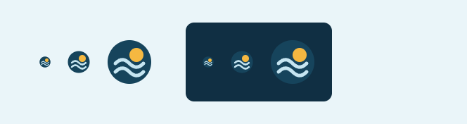

# Weather Lab

[](https://github.com/cristianworth/weather-lab/actions/workflows/pages.yml)

**[Abrir a aplicação](https://cristianworth.github.io/weather-lab/)**

**Seu tempo, em perspectiva.** Um painel de previsão do tempo para explorar condições atuais, temperatura e chuva por localidade.

Projeto open source criado por [Cristian](https://github.com/cristianworth), com código sob a [licença MIT](LICENSE). A interface e a documentação principal estão em português do Brasil.

## Objetivo

O Weather Lab organiza a previsão em uma visão rápida do presente e em detalhes dos próximos dias. O objetivo é facilitar a comparação de temperatura, quantidade de chuva e probabilidade de precipitação ao longo do dia.

Planejar deslocamentos, escolher o que vestir ou organizar uma atividade ao ar livre são exemplos de uso. O aplicativo é um painel geral e deixa a decisão com a pessoa que consulta a previsão.

O projeto também registra uma experiência de desenvolvimento com auxílio de IA e práticas de Spec-Driven Development (SDD): requisitos, decisões técnicas, implementação e validação ficam disponíveis no mesmo repositório. O [relato do desenvolvimento](docs/development.md) explica o processo e seus limites.

## Estado do projeto

Versão inicial **0.1.0**, com aplicação funcional, testes e build de produção. A aplicação é publicada no [GitHub Pages](https://cristianworth.github.io/weather-lab/) por um workflow que valida a entrega antes do deploy.

## Amostras para portfólio

Capturas reais da versão de produção em 27/10/2026, usando a localidade inicial São Paulo. Os valores meteorológicos mudam com o tempo; as imagens registram a interface naquele momento.


<details>
<summary>Ver a interface em celular e no modo escuro</summary>

<p>
  
  
</p>

</details>



As imagens selecionadas em `docs/images/` são versionadas para apresentação do projeto. Resultados brutos continuam em `test-results/`, ignorados pelo Git. Para atualizar a galeria, execute uma prévia e use `npm run screenshots`; o endereço pode ser definido por `WEATHER_LAB_URL`, conforme o [guia de contribuição](CONTRIBUTING.md).

## Recursos

- Busca de localidades com estado e país, incluindo navegação por teclado.
- Condições atuais, sensação térmica, vento e umidade.
- Previsão de sete dias, com seleção do dia para explorar os detalhes.
- Gráficos interativos de temperatura e chuva por hora, com tabela acessível.
- Chuva em milímetros e probabilidade de precipitação em porcentagem, identificadas separadamente.
- Nascer e pôr do sol, índice UV e resumo horário.
- Localização do dispositivo mediante solicitação, favoritos, °C/°F e modo escuro.
- Persistência local de cidade, favoritos e preferências; estados de carregamento, erro e nova tentativa.

Dados reais da [Open-Meteo](https://open-meteo.com/), localidades baseadas no [GeoNames](https://www.geonames.org/) e atribuição [CC BY 4.0](https://creativecommons.org/licenses/by/4.0/). A cidade inicial é São Paulo e pode ser alterada na busca; não representa a localização inferida do visitante.

## Identidade visual: Horizonte


Em 27/10/2026, a interface foi redesenhada para aproximar sua identidade do tema meteorológico e melhorar a leitura dos dados. A direção **Horizonte** combina uma janela azul para o tempo atual, uma faixa contínua de previsão e gráficos com cores próprias para temperatura e chuva.

### Problema e decisões

| Antes                                                        | Redesign                                                      | Intenção                                                     |
| ------------------------------------------------------------ | ------------------------------------------------------------- | ------------------------------------------------------------ |
| Monograma “W” dentro de um quadrado arredondado              | Símbolo vetorial original com sol e duas linhas de horizonte  | Criar uma marca reconhecível na aba e no cabeçalho           |
| Barra lateral permanente e cartões semelhantes               | Navegação horizontal, painel atual dominante e faixa semanal  | Dar mais espaço à previsão e distinguir níveis de informação |
| Superfícies neutras e verde discreto                         | Azul atlântico, cobalto, céu e âmbar                          | Vincular a identidade ao céu e separar funções visuais       |
| DM Sans/Manrope e rótulos pequenos                           | Barlow para leitura e Barlow Condensed para títulos e números | Aumentar a presença tipográfica com uma hierarquia legível   |
| Chamadas decorativas, letras maiúsculas e metáforas em erros | Textos diretos em sentence case                               | Explicar dados, estados e ações com clareza                  |

### Paleta e tipografia

| Token     | Hex       | Papel                                         |
| --------- | --------- | --------------------------------------------- |
| Atlântico | `#16445C` | Cabeçalho, marca e dia selecionado            |
| Cobalto   | `#2459BE` | Condições atuais, ações e chuva no tema claro |
| Céu       | `#C6E5F1` | Superfícies secundárias e contraste da marca  |
| Âmbar     | `#F5B841` | Sol e indicador da seleção semanal            |
| Gelo      | `#EAF5F9` | Fundo do tema claro                           |
| Tinta     | `#132B3A` | Texto principal                               |

O modo escuro usa fundos azuis profundos e cores de texto ajustadas. Cores funcionais adicionais, como o âmbar escuro da curva de temperatura, são derivadas para preservar contraste sobre superfícies claras. A seleção do dia usa também marcador e estado acessível; quantidade e probabilidade mantêm rótulos e unidades.

A família Barlow, de Jeremy Tribby, oferece larguras relacionadas e uma linguagem de sinalização adequada à leitura de informação. A escolha de Barlow Condensed nos títulos e números dá personalidade ao painel sem recorrer a outra família sem relação. A escala vai de 12–16 px nos detalhes a 27–52 px nos títulos e cerca de 106–110 px na temperatura principal, com ajustes por largura de tela. Textos explicativos têm largura de leitura limitada.

### Marca e ilustração

O [favicon SVG](public/favicon.svg) é o arquivo canônico da marca; o componente `BrandMark` reutiliza o mesmo recurso no cabeçalho, rodapé e modal. O desenho usa círculo, disco solar e duas curvas abertas, com poucos elementos para manter a silhueta em 16, 32 e 64 pixels. A URL versionada do favicon permite atualizar a identidade na aba.

A ilustração das condições atuais também é SVG próprio. Sol/lua, nuvens e precipitação acompanham a categoria meteorológica. As linhas curvas se inspiram na linguagem dos mapas atmosféricos, mas são composição de marca: não representam pressão medida, trajetórias de vento nem uma escala meteorológica. A informação quantitativa fica nos dados e nos gráficos.

### Fontes e referências de design

- [NOAA — Surface Weather Plots](https://www.noaa.gov/jetstream/wxmaps-max): referência conceitual de síntese visual e organização de informação meteorológica. Os desenhos do projeto são originais.
- [Barlow, projeto de Jeremy Tribby](https://github.com/jpt/barlow): origem e características da família tipográfica. Licenças oficiais de [Barlow](https://github.com/google/fonts/blob/main/ofl/barlow/OFL.txt) e [Barlow Condensed](https://github.com/google/fonts/blob/main/ofl/barlowcondensed/OFL.txt), sob SIL OFL 1.1.
- [W3C — contraste de texto](https://www.w3.org/WAI/WCAG22/Understanding/contrast-minimum.html) e [contraste não textual](https://www.w3.org/WAI/WCAG22/Understanding/non-text-contrast.html): referências para leitura, controles, indicadores e gráficos. A análise automatizada é complementada por conferência visual, sem alegação de certificação.

Para reproduzir a apresentação, execute o aplicativo e os testes de navegador. Eles geram capturas em `test-results/`, fora do histórico, incluindo estudos do símbolo em fundos claro/escuro. Os fluxos de busca, favoritos, unidades, seleção de dias e persistência foram preservados no redesign.

## Executar

Requer Git, Node.js 22.12+ e npm. Ambiente validado com Node.js 24 e Microsoft Edge no Windows. As consultas à previsão precisam de internet.

```sh
git clone https://github.com/cristianworth/weather-lab.git
cd weather-lab
npm ci
npm run dev
```

Abra o endereço local informado pelo Vite, normalmente `http://127.0.0.1:5173/`. Não é necessária chave de API ou arquivo `.env`. Se já estiver dentro de um clone, comece em `npm ci`.

## Comandos

| Comando                | Finalidade                                          |
| ---------------------- | --------------------------------------------------- |
| `npm run dev`          | Iniciar o servidor de desenvolvimento               |
| `npm test`             | Executar os testes de domínio e componentes         |
| `npm run test:watch`   | Acompanhar testes durante o desenvolvimento         |
| `npm run test:e2e`     | Executar cenários de navegador com Playwright       |
| `npm run test:pages`   | Verificar o build em `/weather-lab/`                |
| `npm run screenshots`  | Atualizar as capturas selecionadas para o portfólio |
| `npm run build`        | Verificar os tipos e gerar a aplicação em `dist/`   |
| `npm run preview`      | Servir localmente o build já gerado                 |
| `npm run format`       | Formatar código e documentação                      |
| `npm run format:check` | Verificar a formatação sem modificar arquivos       |

Para conferir uma alteração:

```sh
npm test
npm run build
npm run preview
```

Para os testes de navegador, no Windows com Microsoft Edge instalado:

```sh
npm run test:e2e
```

O Playwright inicia a aplicação na porta 4178 ou reutiliza uma prévia existente fora de CI. A suíte de produção usa a porta 4180 e o subcaminho `/weather-lab/`. Os cenários de integração consultam a API real; o cenário de recuperação usa uma resposta controlada. A configuração de Chromium em outros ambientes e a conferência prática estão no [guia de contribuição](CONTRIBUTING.md). Capturas e traces ficam em `test-results/`, fora do Git.

## Publicação e checks

O workflow [Checks and Pages](.github/workflows/pages.yml) roda em pushes e pull requests para `main`. Ele instala as dependências, confere a formatação, executa os testes, gera o build com `--base=/weather-lab/` e verifica no Chromium os cenários de recuperação e marca com respostas controladas. A suíte completa com API real também pode ser executada localmente.

Quando essas verificações passam em um push para `main`, o job de deploy publica o artefato no GitHub Pages. Pull requests executam as verificações sem publicar. As actions oficiais estão fixadas por SHA. O badge acima mostra o resultado real do workflow.

Para conferir o mesmo build localmente:

```sh
npm run build -- --base=/weather-lab/
npm run test:pages
```

Para abrir a versão de produção com uma prévia manual:

```sh
npm run preview -- --base=/weather-lab/
```

Use o endereço com `/weather-lab/` impresso pelo Vite. Referências: [Vite e GitHub Pages](https://vite.dev/guide/static-deploy.html#github-pages) e [workflows de GitHub Pages](https://docs.github.com/en/pages/getting-started-with-github-pages/using-custom-workflows-with-github-pages).

## Tecnologias e qualidade

React, TypeScript, Vite, CSS e gráficos SVG. Vitest e Testing Library verificam domínio e interface; Playwright e axe verificam os fluxos no navegador e critérios automatizáveis de acessibilidade. As versões exatas estão no lockfile.

A aplicação consulta a API diretamente e não precisa de backend ou banco de dados para o escopo atual. Preferências ficam no navegador; não há sincronização entre dispositivos. Barlow e Barlow Condensed são carregadas pelo Google Fonts, com fallback local.

O [guia de arquitetura](docs/architecture.md) descreve contratos e fluxo de dados. O [documento de privacidade](docs/privacy.md) explica armazenamento e requisições a terceiros.

## Limitações e publicação

- A previsão depende da disponibilidade e dos limites dos serviços externos; não há previsão offline.
- Preferências e favoritos pertencem ao navegador e à origem do site, sem sincronização entre dispositivos.
- A geolocalização depende de permissão e de um contexto seguro, como HTTPS ou localhost.
- A análise automatizada de acessibilidade cobre estados específicos; não equivale a uma avaliação completa com tecnologias assistivas.
- O resultado de `npm run build` pode ser servido por uma hospedagem estática. `npm run preview` é uma ferramenta de conferência local, não uma configuração de produção.

O código MIT permite reutilização, inclusive comercial, preservando seus avisos. O acesso gratuito à API segue separadamente as [condições não comerciais da Open-Meteo](https://open-meteo.com/en/terms). Verifique essas condições antes de hospedar uma instância para uso promocional ou comercial. Uma previsão pode mudar e não substitui os alertas oficiais.

## Contribuir e reportar problemas

Correções, melhorias de acessibilidade, testes e documentação são bem-vindos. Consulte [CONTRIBUTING.md](CONTRIBUTING.md) e o [código de conduta](CODE_OF_CONDUCT.md). Use as [issues](https://github.com/cristianworth/weather-lab/issues) para bugs e propostas; vulnerabilidades seguem [SECURITY.md](SECURITY.md).

## Licença e créditos

Código original e documentação do projeto: [MIT](LICENSE), escolhida por Cristian. Dependências, fontes e dados mantêm suas próprias licenças e atribuições. Os avisos das dependências de execução estão em [THIRD_PARTY_NOTICES.md](THIRD_PARTY_NOTICES.md).

## Documentação

- [Especificação do painel](docs/spec.md).
- [Como o projeto foi desenvolvido](docs/development.md).
- [Arquitetura e fluxo de dados](docs/architecture.md).
- [Privacidade e serviços externos](docs/privacy.md).
- [Plano técnico e decisões](docs/plan.md).
- [Tarefas e validação](docs/tasks.md).
- [Pesquisa inicial e consultas executadas](docs/research.md).
- [Ponto de retomada](docs/checkpoint.md).

O projeto começou como uma tutoria de SDD. Em 22/10/2026, Cristian escolheu a implementação autônoma, com perguntas apenas sobre decisões relevantes da experiência. O [roteiro de tutoria inicial](docs/learning-path.md) fica preservado como histórico.

Repositório público: [cristianworth/weather-lab](https://github.com/cristianworth/weather-lab).
