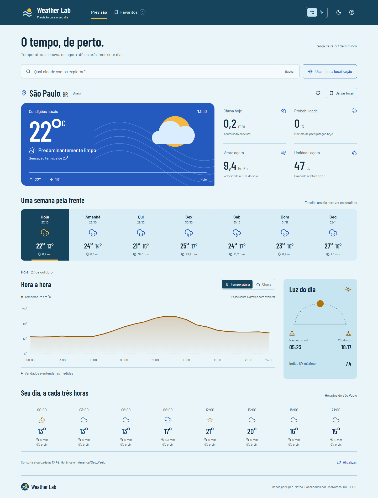
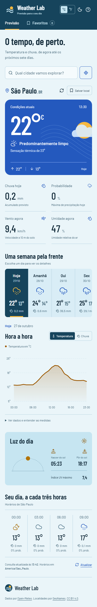
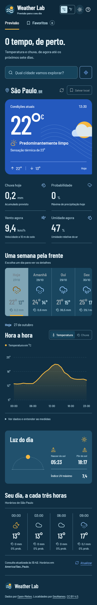

# Weather Lab

Previsão do tempo para explorar condições atuais, temperatura e chuva por localidade. Veja os próximos dias, compare os horários e encontre as informações para planejar sua rotina.

## Experimente online

[](https://cristianworth.github.io/weather-lab/)

**[Abrir o Weather Lab no navegador](https://cristianworth.github.io/weather-lab/)** — sem conta, instalação ou chave de API. Pesquise uma cidade, selecione um dia e explore os gráficos. Os dados meteorológicos são reais e mudam com o tempo.



<details>
<summary>Ver no celular e no modo escuro</summary>




</details>

Capturas da versão de produção em 27/10/2026, com São Paulo como localidade inicial. A cidade inicial não representa a localização inferida do visitante.

## O que você pode fazer

- Pesquisar localidades com cidade, região e país, ou solicitar a localização do dispositivo.
- Consultar condições atuais e previsão dos próximos dias.
- Explorar temperatura e chuva por hora em gráficos e tabela acessível.
- Distinguir quantidade de chuva, em milímetros, de probabilidade de precipitação, em porcentagem.
- Consultar nascer/pôr do sol, índice UV e resumo horário.
- Salvar favoritos e preferências neste navegador, alternar °C/°F e modo claro/escuro.

Planejar transporte, roupa ou uma atividade ao ar livre são exemplos de uso. O painel apresenta a previsão; a decisão fica com quem consulta.

## Stack e decisões

React, TypeScript, Vite, CSS e gráficos SVG. A interface consulta a Open-Meteo diretamente; o escopo atual não precisa de backend ou banco de dados. Vitest/Testing Library e Playwright verificam regras, componentes e fluxos de navegador.

Horários seguem o fuso da localidade consultada. Favoritos e preferências ficam no navegador, sem sincronização entre dispositivos. [Arquitetura](docs/architecture.md) e [privacidade e serviços externos](docs/privacy.md).

## Executar localmente

Requer Git, Node.js 22.12+ e npm. As consultas à previsão precisam de internet; não é necessária chave de API ou arquivo de configuração privado.

```sh
git clone https://github.com/cristianworth/weather-lab.git
cd weather-lab
npm ci
npm run dev
```

Abra o endereço informado pelo Vite, normalmente **http://127.0.0.1:5173/**. [Comandos, build e publicação](docs/deployment.md).

## Estado e limites

Versão funcional **0.1.0**, publicada no GitHub Pages. Previsões dependem da disponibilidade dos serviços e podem mudar; não substituem alertas oficiais. Geolocalização exige permissão e contexto seguro. A verificação automatizada de acessibilidade cobre os estados exercitados, sem certificar acessibilidade completa.

Cristian definiu o produto e avaliou as entregas; a implementação usa assistência de IA e desenvolvimento orientado por especificação. [Processo e limites](docs/development.md). A identidade Horizonte e suas referências estão no [estudo visual](docs/visual-design.md).

## Verificar e contribuir

```sh
npm test
npm run build
```

[Checks and Pages](https://github.com/cristianworth/weather-lab/actions/workflows/pages.yml) verifica a entrega antes da publicação. [Cenários de navegador e build Pages](docs/deployment.md), [contribuição](CONTRIBUTING.md), [segurança](SECURITY.md) e [código de conduta](CODE_OF_CONDUCT.md).

## Documentação e créditos

- [Especificação](docs/spec.md), [plano](docs/plan.md) e [tarefas e validação](docs/tasks.md).
- [Arquitetura](docs/architecture.md), [privacidade](docs/privacy.md) e [ponto de retomada](docs/checkpoint.md).
- [Identidade visual](docs/visual-design.md) e [publicação](docs/deployment.md).

Código original e documentação sob [MIT](LICENSE). Dados da [Open-Meteo](https://open-meteo.com/), localidades baseadas no [GeoNames](https://www.geonames.org/) e atribuição [CC BY 4.0](https://creativecommons.org/licenses/by/4.0/). O serviço de API mantém suas próprias [condições de uso](https://open-meteo.com/en/terms), separadas da licença do código. [Materiais de terceiros](THIRD_PARTY_NOTICES.md).
