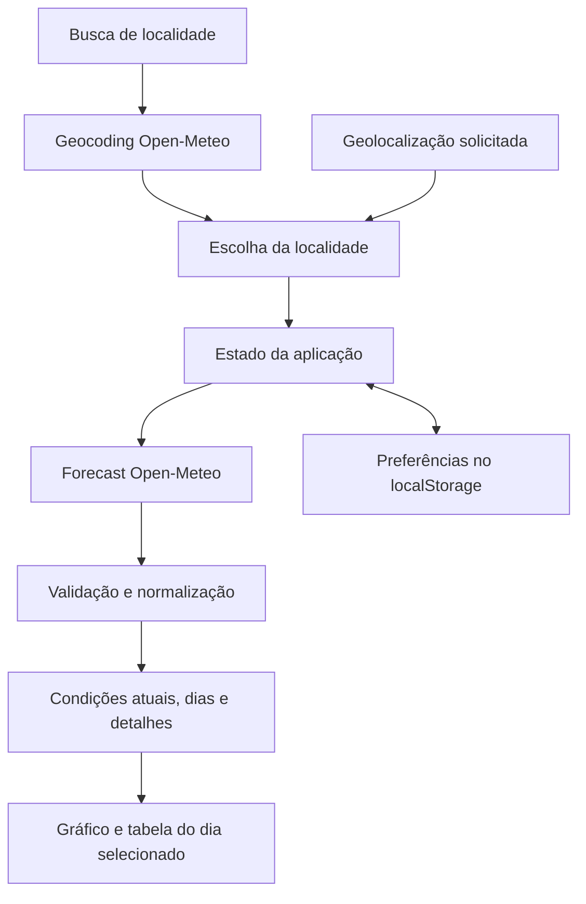

# Arquitetura e dados

O Weather Lab é uma aplicação de página única executada no navegador. Vite serve o código em desenvolvimento e produz arquivos estáticos para distribuição. Não há API própria, banco ou renderização no servidor.

## Fluxo principal

A busca utiliza a API de geocoding da Open-Meteo, baseada em GeoNames. A aplicação não acessa diretamente o serviço GeoNames.

## Organização

| Caminho                               | Responsabilidade                                                                                 |
| ------------------------------------- | ------------------------------------------------------------------------------------------------ |
| `src/main.tsx`                        | Inicializar React e carregar estilos                                                             |
| `src/App.tsx`                         | Compor o painel e coordenar localidade, consulta, dia, favoritos, unidade, tema e geolocalização |
| `src/components/LocationSearch.tsx`   | Busca com debounce, cancelamento e teclado                                                       |
| `src/components/ForecastChart.tsx`    | Gráfico SVG responsivo, exploração dos horários e tabela alternativa                             |
| `src/components/WeatherIcon.tsx`      | Representação dos códigos meteorológicos                                                         |
| `src/lib/weather.ts`                  | Tipos, requisições, validação, normalização e formatação                                         |
| `src/lib/storage.ts`                  | Persistência validada e tolerante a falhas                                                       |
| `src/styles.css`                      | Identidade visual, layouts, foco e temas                                                         |
| `src/test/` e arquivos `*.test.ts(x)` | Fixtures e testes de domínio/componentes                                                         |
| `e2e/`                                | Fluxos de navegador e análise automatizada de acessibilidade                                     |

## Contratos e medidas

Desde o redesign Horizonte, `BrandMark.tsx` compartilha o favicon SVG entre cabeçalho, rodapé e modal, e `SkyArt.tsx` desenha a ilustração atmosférica decorativa segundo a categoria meteorológica. A navegação é horizontal. A identidade e suas referências estão documentadas no README; os contratos da API permanecem os mesmos.

`Location` representa o local escolhido. `Forecast` contém o fuso, o instante da consulta, condições atuais e coleções de `HourForecast` e `DayForecast`. O JSON externo é tratado como dado desconhecido e validado antes de alimentar a interface.

Temperaturas são consultadas e mantidas em Celsius; Fahrenheit é uma conversão de apresentação. Chuva é `rain + showers`, em milímetros. Probabilidade de precipitação permanece separada, em porcentagem. Se um componente da soma está ausente, o resultado fica indisponível em vez de assumir zero.

Instantes Unix são formatados com `Intl.DateTimeFormat` usando o fuso retornado pelo fornecedor. O agrupamento por dia também usa esse fuso. O instante de atualização da tela e o horário das condições atuais são campos distintos. A interpretação do intervalo da chuva fica visível no gráfico e na tabela.

## Requisições e estados

A busca espera 350 ms após a digitação e solicita até seis opções a partir de dois caracteres. Mudanças de busca abortam consultas anteriores. A previsão solicita sete dias com unidades explícitas e `timezone=auto`.

O cliente HTTP possui timeout de 15 segundos. Rede indisponível, erros HTTP, limite de consultas e dados incompletos têm tratamento próprio. O estado associado à localidade e a checagem de aborto impedem uma resposta antiga de substituir uma seleção mais recente.

O painel apresenta carregamento, sucesso ou erro com nova tentativa. Não há previsões fictícias como fallback. A previsão não é persistida para uso offline nem existe atualização periódica automática; novas consultas ocorrem ao abrir, mudar de localidade ou solicitar atualização.

## Decisões e evolução

React coordena os estados interativos; TypeScript explicita contratos; CSS e SVG permitem uma interface própria com poucas dependências de execução. A ausência de uma responsabilidade de servidor justificou a consulta diretamente no navegador. O [plano técnico](plan.md) registra essas escolhas.

Uma necessidade futura de segredo de API, autenticação, sincronização entre dispositivos ou gravação compartilhada pode justificar backend. O build lê a versão de `package.json` para evitar números duplicados na interface.
